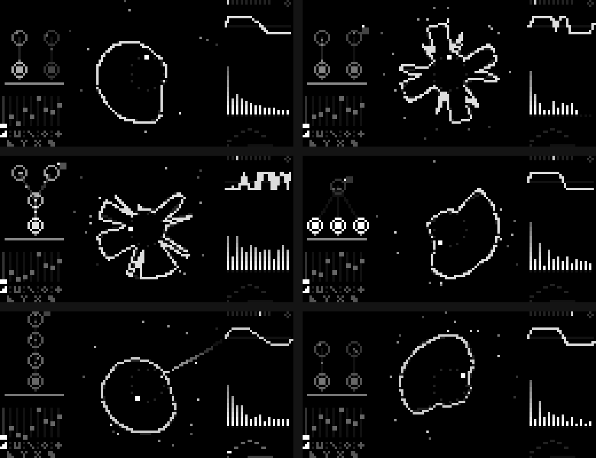
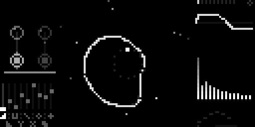
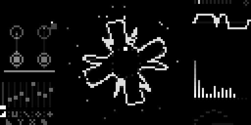
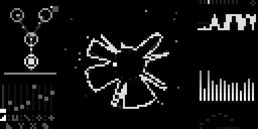
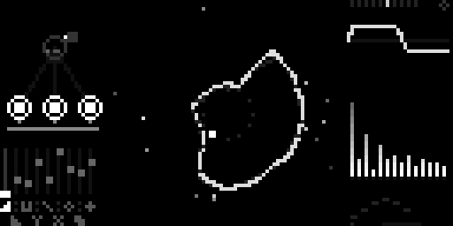
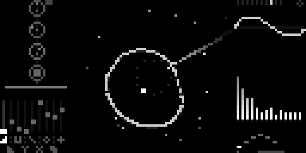
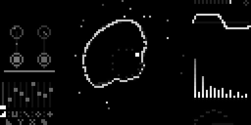

[English](README.md) · [Español](README.es.md) · [Français](README.fr.md) · **Deutsch** · [日本語](README.ja.md) · [中文](README.zh.md) · [हिन्दी](README.hi.md)

# Chordex FM

Ein Akkordinstrument mit einer FM-Engine mit 4 Operatoren (im Stil von DX /
TX81Z) für [monome norns](https://monome.org/docs/norns/). Eine Taste spielt
einen vierstimmigen Akkord plus Bass; die tiefste gehaltene Taste bestimmt den
Grundton.



**Das Display ist die FM**, gezeichnet mit derselben Formel, die den Klang
erzeugt:

- **links, der Algorithmus:** 4 Operatoren als Kreise. Ihre Helligkeit ist
  ihre Hüllkurve, der Punkt darin dreht sich im Tempo seines Ratios, die
  Linien sind die Modulation (wandernde Partikel = wie viel Index), die
  Schleife an Operator 4 ist sein Feedback. Darunter die 9 Fader.
- **Mitte, die Blume:** die echte Wellenform des Tons in Polardarstellung. Bei
  niedrigem Index ein weicher Kreis, bei hohem Index voller Blütenblätter und
  Zacken. Die Geisterkontur ist Fatness, Funken sind Shimmer und Knistern, und
  innen sitzt der Akkord auf einem 12-Ton-Rad. Jeder Arpeggio-Ton fliegt als
  Komet hinaus.
- **rechts:** Oszilloskop (eine Periode) und Spektrum (die Obertöne und
  Seitenbänder der FM); darunter das Arpeggio-Muster.

## Funktionen

- **FM mit 4 Operatoren**: 8 Algorithmen, Ratios, Feedback von Operator 4,
  eine Hüllkurve pro Operator und ein „Sweep“ der Modulatoren
- **10 Modelle**: EPIANO, CAMPANA (Glocke), METAL, CORO (Chor), BAJO (Bass),
  ORGANO (Orgel), MARIMBA, CUERDAS (Streicher), FLAUTA (Flöte), VIDRIO (Glas)
- **10 Akkorde**: maj, min, dim, aug, 7, maj7, min7, m7b5, sus2, sus4
- **Arpeggiator**: up, down, up-down, up x2, down x2, random und *arpa*
  (Harfe); Gate auf Maximum = echtes Legato
- **Akkordmodus** an/aus (aus = Einzeltöne) und **Halten**
- folgt eingehender MIDI-Clock für das Arpeggio-Tempo
- alle Einstellungen werden automatisch gespeichert

Teil der Chordex-Familie: dieselbe Bedienung wie Chordex80.

<!-- u-ma:family -->
## Die Chordex-Familie

Gleiche Bedienung, andere Engines. Probier die anderen aus:

| | |
|---|---|
| <a href="https://github.com/buenosairesfront/chordex80/blob/main/README.de.md"></a> | **[Chordex 80](https://github.com/buenosairesfront/chordex80/blob/main/README.de.md)**<br>80er-Polysynth mit Outrun-Sonnenuntergang<br>`;install https://github.com/buenosairesfront/chordex80` |
| <a href="https://github.com/buenosairesfront/chordexstg/blob/main/README.de.md"></a> | **[ChordexSTG](https://github.com/buenosairesfront/chordexstg/blob/main/README.de.md)**<br>Orchesterstreicher mit echter Bewegung einer gestrichenen Saite<br>`;install https://github.com/buenosairesfront/chordexstg` |
| <a href="https://github.com/buenosairesfront/chordexwt/blob/main/README.de.md"></a> | **[Chordex WT](https://github.com/buenosairesfront/chordexwt/blob/main/README.de.md)**<br>Wavetable: 8 Bänke mit je 8 Wellen, als 3D-Tabelle gezeichnet<br>`;install https://github.com/buenosairesfront/chordexwt` |
| <a href="https://github.com/buenosairesfront/chordexchip/blob/main/README.de.md"></a> | **[Chordex CHIP](https://github.com/buenosairesfront/chordexchip/blob/main/README.de.md)**<br>Chiptune: 8 Konsolenchips × 8 Presets, als Tracker gezeichnet<br>`;install https://github.com/buenosairesfront/chordexchip` |

**Mehr von U-MA:** alle Instrumente und Werkzeuge an einem Ort → [U-MA-Übersicht](https://github.com/buenosairesfront/U-ma/blob/main/README.de.md)
<!-- /u-ma:family -->

## Voraussetzungen

- norns (shield, Standard oder fates)
- ein MIDI-Keyboard oder -Controller

## Installation

In maiden:

```
;install https://github.com/buenosairesfront/chordexfm
```

Danach **norns neu starten** (SYSTEM > RESTART), damit die neue Engine
`ChordexFM` kompiliert wird, und **chordexfm** über SELECT laden.

## Bedienung

| Bedienelement | Funktion |
|---|---|
| E1 | FM-Index (Helligkeit) |
| E2 | Fader wählen |
| E3 | Fader einstellen |
| K3 + E1 | Modell |
| K3 + E2 | Feedback von Operator 4 |
| K3 + E3 | Akkordtyp |
| K3 halten (ohne zu drehen) | Akkordmodus an/aus |
| K2 (antippen) | Arpeggiator an/aus |
| K2 + E1 | Arpeggio-Gate (Maximum = Legato) |
| K2 + E2 | Arpeggio-Muster |
| K2 + E3 | Arpeggio-Geschwindigkeit |
| K1 halten | Halten an/aus (kleiner Punkt oben rechts) |

**Fader:** Attack, Decay, Ratio von Operator 2, Algorithmus, Sweep (Decay der
Modulatoren), Verzerrung, Wobble, Fatness, Shimmer.

**Menü PARAMETERS:** MIDI-Kanal (0 = alle, Standard), MIDI-Clock-Teiler,
Hall, Lautstärke und alles oben Genannte.

## Galerie

| | |
|---|---|
|  EPIANO · maj7 |  CAMPANA (Glocke) |
|  METAL · hoher Index |  ORGANO (Orgel) |
|  CUERDAS (Streicher) · Arpeggio |  VIDRIO (Glas) |

## Credits

Erstellt von [Buenos Aires Front](https://github.com/buenosairesfront) / U-MA.
MIT-Lizenz.
