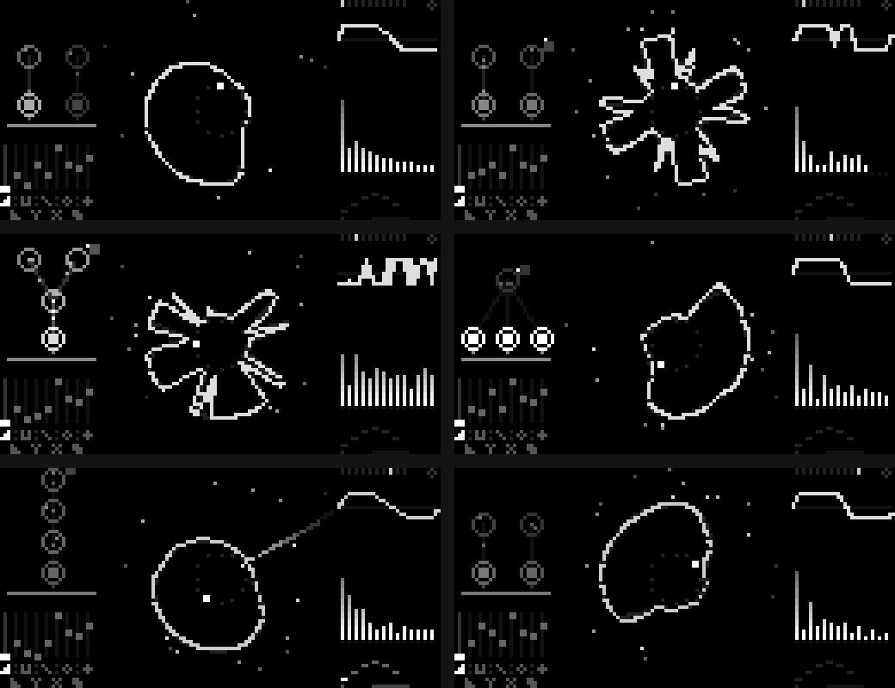
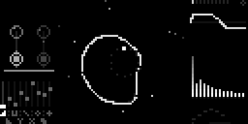
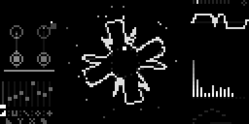
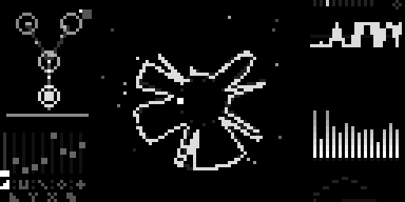
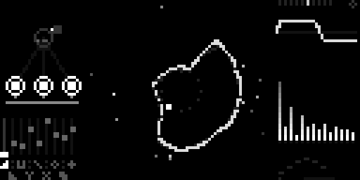
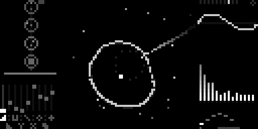
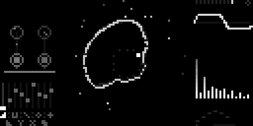

**English** · [Español](README.es.md) · [Français](README.fr.md) · [Deutsch](README.de.md) · [日本語](README.ja.md) · [中文](README.zh.md) · [हिन्दी](README.hi.md)

# Chordex FM

A chord instrument with a 4-operator FM engine (DX / TX81Z style) for
[monome norns](https://monome.org/docs/norns/). One key plays a four-note chord
plus bass; the lowest key held sets the root.



**The screen is the FM**, drawn with the same formula that makes the sound:

- **left, the algorithm:** 4 operators as circles. Their brightness is their
  envelope, the dot spinning inside turns at the speed of its ratio, the lines
  are the modulation (travelling particles = how much index), and the loop on
  operator 4 is its feedback. Below, the 9 faders.
- **center, the flower:** the real waveform of the note drawn in polar form.
  At low index it is a smooth circle; at high index it fills with petals and
  spikes. The ghost outline is fatness, sparks are shimmer and crackle, and
  inside sits the chord on a 12-note wheel. Each arpeggio note flies out as a
  comet.
- **right:** oscilloscope (one cycle) and spectrum (the harmonics and
  sidebands FM creates); below, the arpeggio pattern.

## Features

- **4-operator FM**: 8 algorithms, ratios, operator 4 feedback, an envelope
  per operator and a modulator "sweep"
- **10 models**: EPIANO, CAMPANA (bell), METAL, CORO (choir), BAJO (bass),
  ORGANO (organ), MARIMBA, CUERDAS (strings), FLAUTA (flute), VIDRIO (glass)
- **10 chords**: maj, min, dim, aug, 7, maj7, min7, m7b5, sus2, sus4
- **arpeggiator**: up, down, up-down, up x2, down x2, random and *arpa*
  (harp); gate at maximum = real legato
- **chord mode** on/off (off = single notes) and **hold**
- follows incoming MIDI clock for the arpeggio tempo
- all settings are saved automatically

Part of the Chordex family: same controls as Chordex80.

<!-- u-ma:family -->
## The Chordex family

Same controls, different engines. Try the others:

| | |
|---|---|
| <a href="https://github.com/buenosairesfront/chordex80"></a> | **[Chordex 80](https://github.com/buenosairesfront/chordex80)**<br>'80s polysynth with an outrun sunset<br>`;install https://github.com/buenosairesfront/chordex80` |
| <a href="https://github.com/buenosairesfront/chordexstg"></a> | **[ChordexSTG](https://github.com/buenosairesfront/chordexstg)**<br>orchestral strings with real bowed-string motion<br>`;install https://github.com/buenosairesfront/chordexstg` |
| <a href="https://github.com/buenosairesfront/chordexwt"></a> | **[Chordex WT](https://github.com/buenosairesfront/chordexwt)**<br>wavetable: 8 banks of 8 waves, drawn as a 3D table<br>`;install https://github.com/buenosairesfront/chordexwt` |
| <a href="https://github.com/buenosairesfront/chordexchip"></a> | **[Chordex CHIP](https://github.com/buenosairesfront/chordexchip)**<br>chiptune: 8 console chips × 8 presets, drawn as a tracker<br>`;install https://github.com/buenosairesfront/chordexchip` |
| <a href="https://github.com/buenosairesfront/chordexabnt"></a> | **[Chordex ABNT](https://github.com/buenosairesfront/chordexabnt)**<br>pads, ambient, leads and textures: 4 families × 8 presets, with MOTION instead of an arpeggiator<br>`;install https://github.com/buenosairesfront/chordexabnt` |
| <a href="https://github.com/buenosairesfront/chordexfilo"></a> | **[Chordex Filo](https://github.com/buenosairesfront/chordexfilo)**<br>broken lo-fi mono: one voice and a cloud of grains, with a FAILURE on K2 instead of an arpeggiator<br>`;install https://github.com/buenosairesfront/chordexfilo` |

**More from U-MA:** every instrument and tool in one place → [U-MA showcase](https://github.com/buenosairesfront/U-ma)
<!-- /u-ma:family -->

## Requirements

- norns (shield, standard or fates)
- a MIDI keyboard or controller

## Install

From maiden:

```
;install https://github.com/buenosairesfront/chordexfm
```

Then **restart norns** (SYSTEM > RESTART) so the new engine `ChordexFM` is
compiled, and load **chordexfm** from SELECT.

## Controls

| control | action |
|---|---|
| E1 | FM index (brightness) |
| E2 | select fader |
| E3 | adjust fader |
| K3 + E1 | model |
| K3 + E2 | operator 4 feedback |
| K3 + E3 | chord type |
| K3 held (without turning) | chord mode on/off |
| K2 (tap) | arpeggiator on/off |
| K2 + E1 | arpeggio gate (max = legato) |
| K2 + E2 | arpeggio pattern |
| K2 + E3 | arpeggio speed |
| K1 held | hold on/off (small dot, top right) |

**Faders:** attack, decay, operator 2 ratio, algorithm, sweep (modulator
decay), distortion, wobble, fatness, shimmer.

**PARAMETERS menu:** MIDI channel (1 by default; 0 = all), MIDI clock divider,
hall, volume, and everything above.

## arc and crow

Both are optional: with no arc or crow connected nothing changes.

**arc** (4 rings, drawn as knobs): 1 FM index · 2 op 4 feedback · 3 arpeggio speed · 4 hall

**crow**: IN1 = pitch (V/oct, 0 V = C4), IN2 = gate (plays and releases) · OUT1 = chord root (V/oct) · OUT2 = envelope (0–8 V, with the attack and release of the sound) · OUT3 = tempo-synced LFO (1 bar) · OUT4 = a pulse on every chord or arpeggio step. It can be turned off in PARAMETERS > ARC / CROW.

**Tempo:** on first launch the internal tempo is 50 BPM. Incoming MIDI clock (on any MIDI port) sets the tempo whenever it is present.

## Gallery

| | |
|---|---|
|  EPIANO · maj7 |  CAMPANA (bell) |
|  METAL · high index |  ORGANO (organ) |
|  CUERDAS (strings) · arpeggio |  VIDRIO (glass) |

## Credits

Made by [Buenos Aires Front](https://github.com/buenosairesfront) / U-MA.
Released under the MIT license.
